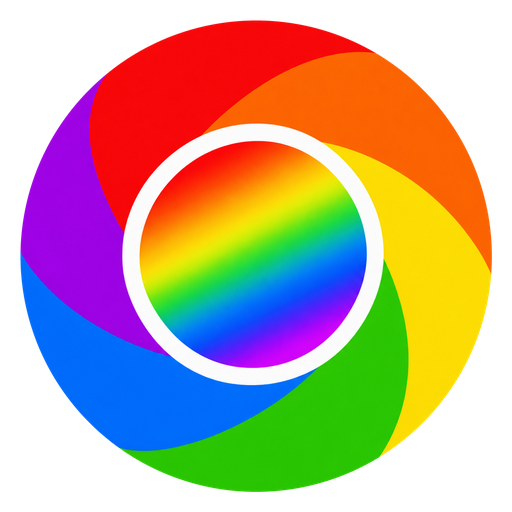
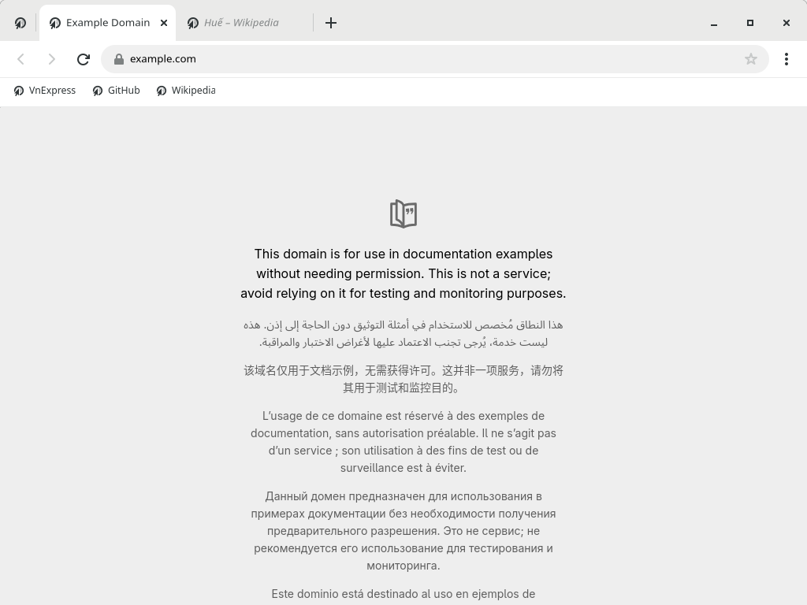

<p align="center">
  
</p>

<h1 align="center">Chỏme</h1>

<p align="center">
  Trình duyệt web nhẹ cho Linux, giao diện quen thuộc như Chrome.
</p>

<p align="center">
  
</p>

## Giới thiệu

Chỏme là trình duyệt dùng engine WebKit, giao diện và phím tắt giống Chrome, nhưng tiết kiệm RAM hơn
khi mở nhiều tab: tab không dùng một lúc sẽ tự "ngủ" để giải phóng bộ nhớ, bấm vào là tải lại.

- Tab, bookmark, lịch sử, tải xuống, cửa sổ ẩn danh, dịch trang — dùng như Chrome
- Chặn quảng cáo có sẵn, kể cả quảng cáo YouTube; nghe nhạc YouTube không bị ngắt bởi hộp "Tiếp tục xem?"
- Giữ đăng nhập, lưu mật khẩu (vào kho khóa của hệ thống) và tự điền, mở lại các tab của lần trước
- Có trình xem JSON và DevTools (F12) cho lập trình viên
- Kết nối được với Claude Code, Codex, Gemini CLI (bật trong Cài đặt → Kết nối AI)

## Cài đặt

Yêu cầu: **Ubuntu 24.04 trở lên** hoặc **Debian 13**, máy tính chip Intel/AMD 64-bit.

1. Tải file `chome_<phiên bản>_amd64.deb` ở [**bản phát hành mới nhất**](https://github.com/LILLINH/chome/releases/latest).
2. Nhấp đúp vào file để cài bằng App Center, hoặc chạy:

   ```bash
   sudo apt install ./chome_*_amd64.deb
   ```

3. Mở **Chỏme** từ menu ứng dụng.

Gỡ cài đặt: `sudo apt remove chome`

**Cập nhật:** khi cài, Chỏme tự thêm kho cập nhật của mình, nên bản mới sẽ đến cùng các cập nhật
khác của Ubuntu (Software Updater hoặc `sudo apt upgrade`). Chỏme cũng tự báo khi có bản mới.

## Build từ mã nguồn

Cần [Rust](https://rustup.rs) bản mới.

```bash
sudo apt install -y build-essential pkg-config libwebkitgtk-6.0-dev libgtk-4-dev
cargo build --release --workspace
./target/release/chome
```

Đóng gói `.deb`: `packaging/build-deb.sh` (kết quả nằm trong thư mục `dist/`).
